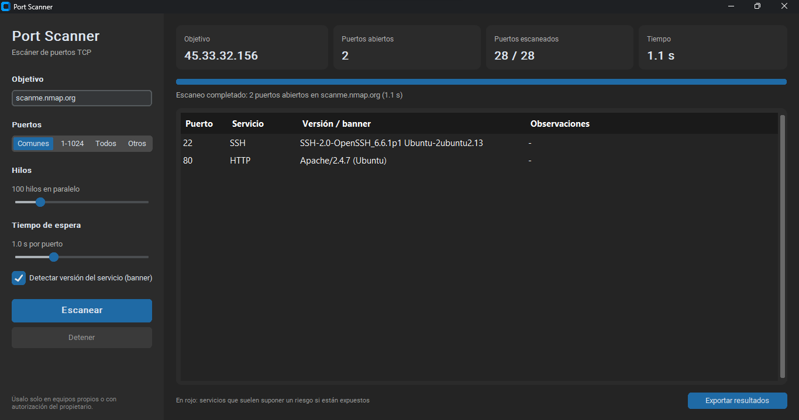

# Port Scanner

Escáner de puertos TCP con interfaz de escritorio, hecho en Python. Le indicas una IP o un dominio y te dice qué puertos tiene abiertos, qué servicio hay detrás de cada uno y si alguno puede suponer un riesgo de seguridad.

Lo hice para entender mejor cómo funcionan las conexiones TCP y cómo trabajan herramientas como Nmap por dentro.



## Qué hace

- Escanea los puertos más comunes, el rango 1-1024, los 65.535 puertos o una lista personalizada (por ejemplo `22,80,443,8000-8100`).
- Usa varios hilos a la vez, así que un escaneo que en serie tardaría minutos se hace en segundos. El número de hilos y el tiempo de espera se pueden ajustar.
- Identifica el servicio de cada puerto abierto (SSH, HTTP, MySQL, RDP...) e intenta leer su banner para saber qué versión está corriendo.
- Marca en rojo los servicios que suelen ser un problema si están expuestos, como Telnet, SMB, RDP o bases de datos accesibles desde la red, con una explicación de por qué.
- Se puede detener a mitad de escaneo.
- Exporta los resultados a CSV o JSON.

## Cómo funciona

Para comprobar cada puerto, el programa intenta abrir una conexión TCP completa (el *three-way handshake*: SYN, SYN-ACK, ACK). Si la conexión se establece, el puerto está abierto; si el equipo la rechaza o no responde dentro del tiempo de espera, se considera cerrado o filtrado.

Cuando un puerto está abierto, el programa lee lo primero que envía el servicio. Muchos servicios se presentan al conectarte (SSH, por ejemplo, responde algo como `SSH-2.0-OpenSSH_8.9`), y eso permite saber qué software y qué versión hay detrás. Los servidores web no envían nada hasta recibir una petición, así que en los puertos HTTP se manda una petición `HEAD` y se lee la cabecera `Server`.

Cada puerto se comprueba en su propio hilo con un `ThreadPoolExecutor`. La interfaz no puede actualizarse desde otros hilos, así que el escaneo va en un hilo aparte y manda los resultados a la ventana a través de una cola. Así la ventana no se congela mientras escanea.

El código está separado en dos partes: `scanner.py`, que hace el escaneo y no sabe nada de la interfaz, y `gui.py`, que solo se encarga de la ventana. Eso permite probar el escáner con tests sin abrir ninguna ventana.

## Instalación

Necesitas Python 3.9 o superior.

```bash
git clone https://github.com/JeanQuezadaC/port-scanner.git
cd port-scanner
pip install -r requirements.txt
```

## Uso

```bash
python -m port_scanner
```

Para probarlo sin riesgo puedes usar `scanme.nmap.org`, un servidor que el proyecto Nmap tiene preparado precisamente para que la gente practique, o tu propio router (normalmente `192.168.1.1`).

Si escribes una dirección pública que no sea de prácticas, la aplicación te pide que confirmes que tienes autorización antes de empezar.

## Tests

```bash
python -m unittest -v
```

Los tests levantan un pequeño servidor TCP en el propio equipo y comprueban que el escáner detecta su puerto como abierto, lee su banner, ignora los puertos cerrados y se detiene cuando se le pide.

## Estructura

```
port-scanner/
├── port_scanner/
│   ├── scanner.py   # lógica del escaneo
│   └── gui.py       # interfaz con CustomTkinter
├── tests/
│   └── test_scanner.py
└── requirements.txt
```

## Limitaciones

- Solo hace escaneo TCP *connect*. No hace escaneos SYN ("semiabiertos") ni UDP, que necesitan permisos de administrador y enviar paquetes a bajo nivel.
- No distingue entre puertos cerrados y filtrados por un firewall: los dos aparecen como no abiertos.
- La detección de versión depende de que el servicio envíe un banner, y no todos lo hacen.

## Ideas para seguir

- Escaneo de varios equipos a la vez (por ejemplo, toda una red `192.168.1.0/24`).
- Distinguir puertos cerrados y filtrados.
- Guardar el historial de escaneos y compararlos para ver qué ha cambiado.

## Uso responsable

Escanear equipos sin permiso puede ser ilegal. Usa esta herramienta solo en tus propios equipos, en tu red o en sistemas en los que tengas autorización expresa.

## Licencia

MIT
